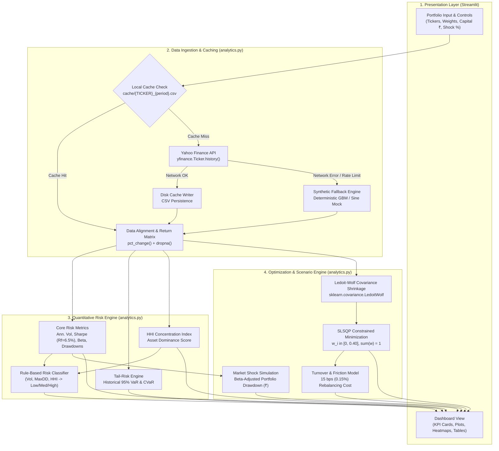
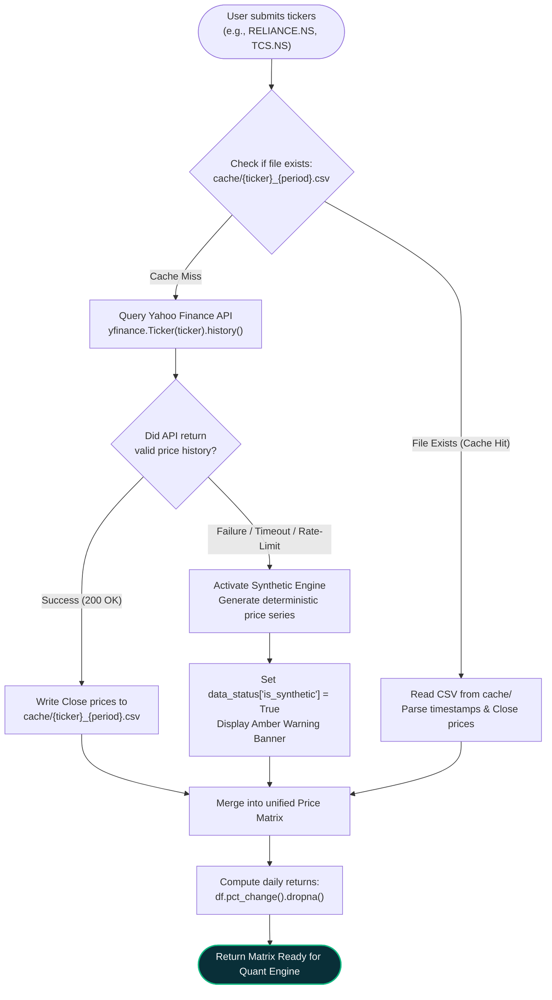
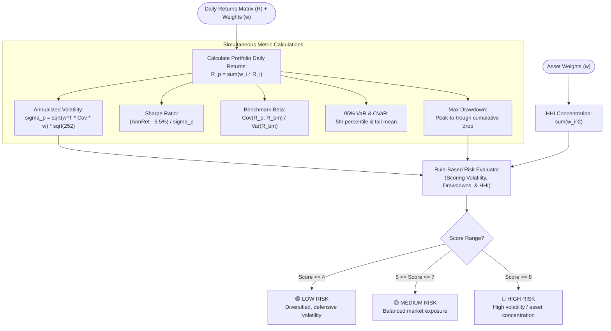
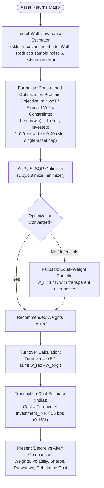
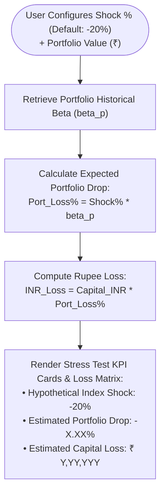

# QUANTECH — End-to-End System Workflow & Architecture

This document provides a detailed, step-by-step breakdown of how the **QUANTECH** platform functions from user input to quantitative processing, risk classification, portfolio optimization, and visualization.

---

## 1. High-Level Architecture Diagram

---

## 2. Market Data Ingestion & Cache Flow

---

## 3. Quantitative Risk Diagnostics Flow

---

## 4. Optimization & Rebalancing Workflow

---

## 5. Stress Testing & Crash Simulation Workflow

---

## 6. Step-by-Step Functional Walkthrough

### Step 1: Portfolio Input & Normalization
* **File Reference:** [`app.py`](app.py) (Sidebar component)
* **What Happens:**
  1. The user inputs Indian stock tickers (defaulting to liquid NSE symbols: `RELIANCE.NS`, `TCS.NS`, `HDFCBANK.NS`, `INFY.NS`, `ICICIBANK.NS`, `ITC.NS`).
  2. The user specifies percentage allocations and total portfolio investment capital (default: ₹1,000,000).
  3. **Validation & Normalization:** If total weights do not sum up to exactly 100%, the application normalizes them proportionately ($w_i' = \frac{w_i}{\sum w_k}$) and presents real-time feedback in the sidebar.

---

### Step 2: Market Data Retrieval & Resilient Caching
* **File Reference:** [`analytics.py`](analytics.py) (`fetch_ticker_data`, `fetch_market_data`)
* **What Happens:**
  1. **Cache-First Lookup:** For each ticker, the system checks the `cache/` directory for a valid local CSV file (e.g., `cache/RELIANCE_NS_3y.csv`).
  2. **API Fetch (Cache Miss):** If not found, it queries Yahoo Finance via `yfinance` for adjusted daily close prices over a 3-year historical horizon.
  3. **Cache Storage:** Downloaded data is instantly serialized to disk to guarantee speed and minimize outbound API calls.
  4. **Demo / Synthetic Fallback:** If the network is unavailable or Yahoo Finance encounters rate limits, `generate_synthetic_data()` generates deterministic geometric return series. The UI displays an amber badge: `⚠️ SYNTHETIC DATA · DEMO MODE`.
  5. **Data Alignment:** All stock series are inner-joined into a unified pandas DataFrame, computing daily percentage returns:
     $$R_{i,t} = \frac{P_{i,t} - P_{i,t-1}}{P_{i,t-1}}$$

---

### Step 3: Quantitative Risk Engine & Analytics
* **File Reference:** [`analytics.py`](analytics.py) (`portfolio_annualized_return`, `portfolio_annualized_volatility`, `sharpe_ratio`, etc.)
* **What Happens:**
  1. **Portfolio Returns:** Daily weighted returns:
     $$R_{p,t} = \sum_{i=1}^N w_i R_{i,t}$$
  2. **Annualized Volatility:** Factoring in 252 trading days:
     $$\sigma_p = \sqrt{w^T \Sigma w} \times \sqrt{252}$$
  3. **Sharpe Ratio:** Evaluated against an Indian Risk-Free Rate assumption ($R_f = 6.5\%$ 91-day T-Bill rate):
     $$\text{Sharpe} = \frac{R_p - R_f}{\sigma_p}$$
  4. **Tail Risk (Historical 95% VaR & CVaR):**
     * **Value at Risk (VaR 95%):** The 5th percentile of historical daily portfolio returns.
     * **Conditional VaR (CVaR / Expected Shortfall):** The mean return of all days where losses exceeded the 95% VaR.
  5. **Maximum Drawdown (Peak-to-Trough):**
     $$\text{Drawdown}_t = \frac{\text{CumRet}_t - \max_{\tau \le t}(\text{CumRet}_\tau)}{\max_{\tau \le t}(\text{CumRet}_\tau)}$$
  6. **Concentration Index (Herfindahl-Hirschman Index - HHI):**
     $$\text{HHI} = \sum_{i=1}^N w_i^2$$
     (Values above 0.25 indicate excessive single-stock concentration).

---

### Step 4: Transparent Rule-Based Risk Classification
* **File Reference:** [`analytics.py`](analytics.py) (`classify_portfolio_risk`)
* **What Happens:**
  * Rather than relying on black-box or hallucinating ML outputs, QUANTECH utilizes a documented scoring matrix evaluating:
    * **Annualized Volatility:** $< 14\%$ (Low), $14\% - 22\%$ (Medium), $> 22\%$ (High).
    * **Historical Max Drawdown:** $< 15\%$ (Low), $15\% - 30\%$ (Medium), $> 30\%$ (High).
    * **HHI Concentration:** $< 0.20$ (Diversified), $0.20 - 0.35$ (Moderate), $> 0.35$ (Concentrated).
  * Points are aggregated into a composite score mapping to **LOW RISK (Green)**, **MEDIUM RISK (Yellow)**, or **HIGH RISK (Red)** with explicit explanatory bullet points.

---

### Step 5: Optimization & Allocation Recommendations
* **File Reference:** [`analytics.py`](analytics.py) (`optimize_min_variance`, `recommend_allocation`)
* **What Happens:**
  1. **Covariance Shrinkage:** Employs the Ledoit-Wolf shrinkage estimator (`sklearn.covariance.LedoitWolf`) to temper noise in sample covariance matrices.
  2. **Constrained Optimization:** Solves for the long-only minimum variance portfolio using `scipy.optimize.minimize` (SLSQP):
     $$\min_w w^T \hat{\Sigma}_{LW} w \quad \text{s.t.} \quad \sum_{i=1}^N w_i = 1, \quad 0 \le w_i \le 0.40$$
     *(A 40% cap prevents single-asset concentration).*
  3. **Fallback:** If optimization fails or data has rank deficiencies, it gracefully reverts to an equal-weight ($1/N$) portfolio with an explanation.
  4. **Turnover & Transaction Costs:** Computes one-way turnover and applies realistic Indian equity transaction friction (brokerage + STT + exchange fees estimated at 15 bps / 0.15%):
     $$\text{Turnover} = \frac{1}{2} \sum_{i=1}^N |w_{i,\text{rec}} - w_{i,\text{orig}}|, \quad \text{Cost} = \text{Turnover} \times \text{Capital} \times 0.0015$$

---

### Step 6: Stress Testing & Backtest Visualization
* **File Reference:** [`analytics.py`](analytics.py), [`app.py`](app.py) (Tabs 1 to 6)
* **What Happens:**
  1. **Historical Backtest:** Tracks the equity curve of ₹100 invested across:
     * User's Original Allocation
     * Recommended Minimum-Variance Allocation
     * Benchmark (NIFTY 50)
     * Equal-Weight Portfolio
  2. **Stress Crash Simulation:**
     * Simulates a configurable index crash (default: $-20\%$).
     * Multiplies the market shock by the portfolio's historical Beta ($\Delta_p = \text{Shock} \times \beta$).
     * Computes the immediate projected rupee drawdown (₹) on the user's capital.

---

## 7. Data & Technology Summary

| Component | Technology / Library | Purpose |
| :--- | :--- | :--- |
| **User Interface** | Streamlit | Fast interactive web application with dark-navy styling |
| **Market Data** | `yfinance` | Official daily adjusted close prices for NSE/BSE |
| **Local Storage** | Flat CSV Cache (`cache/`) | Disk persistence, millisecond reload, offline resilience |
| **Numerical Processing** | `pandas`, `numpy` | Matrix operations, rolling calculations, series transforms |
| **Covariance Shrinkage** | `scikit-learn` (`LedoitWolf`) | Conditioned covariance matrices robust against noise |
| **Optimization** | `scipy.optimize` (`SLSQP`) | Quadratic constrained minimization with inequality bounds |
| **Data Visualization** | `plotly` | Interactive equity charts, underwater drawdowns, heatmaps |
